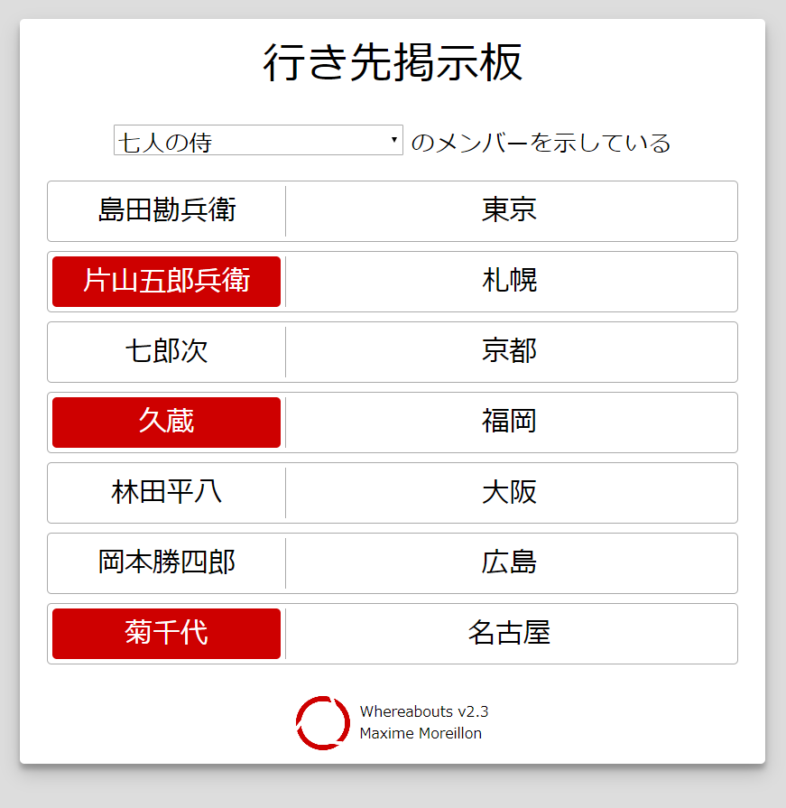

# 行先掲示板 / Whereabouts display board

Many Japanese companies use whiteboards to display the whereabouts of team members.
Those can be useful when quickly trying to figure out if a member is in the office, on a business trip, etc.

  

However, because of COVID-19, more and more employees work from home and can thus not see the whiteboards anymore.
This application offers a solution to the problem by providing the same features but as a web application.
Here, the whereabouts of team members are displayed on a single page application (SPA) and can be easily edited from any device.
The whereabouts are stored in a MongoDB database and their changes are broadcast via WebSockets to all connected clients for real-time updates.

  

This repository contains the source-code for the back-end of the application. The GUI is developed independently and is the object of its own repository (`whereabouts_front`).

## API

All routes except `/` and `/health` require authentication, checked against `IDENTIFICATION_URL`. The JWT can be sent in the `Authorization: Bearer` header, a `jwt` or `token` query parameter, cookie or body field; an API key can be sent in the `X-API-Key` header or an `api_key` query parameter.

| Route                          | Method    | Query / body                           | Description                                                                     |
| ------------------------------ | --------- | -------------------------------------- | ------------------------------------------------------------------------------- |
| /groups/{group_id}/whereabouts | GET       | limit (default 25), skip (default 0)   | Gets the members of a group with their whereabouts                              |
| /users/{user_id}               | PATCH/PUT | availability, message                  | Updates the whereabouts of a user; use `self` for one's own (admins can update anyone) |
| /update                        | GET       | availability, message, jwt             | Legacy: updates the whereabouts of the user identified by the JWT               |

`presence` and `current_location` are accepted as aliases of `availability` and `message`.

| Route         | Method | Description                                            |
| ------------- | ------ | ------------------------------------------------------ |
| /             | GET    | Application info: version, service URLs, DB status     |
| /health/live  | GET    | Liveness probe: the process responds                   |
| /health/ready | GET    | Readiness probe: 503 until MongoDB is connected        |

## WebSocket (Socket.IO)

Clients authenticate either with an `Authorization: Bearer` header when connecting, or by emitting an `authentication` event with `{ jwt }`, and can emit `logout` to end the session. They then emit `get_members_of_group` with a group ID to join that group's room and receive a `members_of_group` event with its members' whereabouts. Every later update of a member is broadcast to the rooms of that member's groups as `members_of_group`.

## Environment variables

| Variable                  | Description                                                                                      | Default     |
| ------------------------- | ------------------------------------------------------------------------------------------------ | ----------- |
| APP_PORT                  | Port used by the HTTP and WebSocket server                                                       | 80          |
| IDENTIFICATION_URL        | URL of the endpoint identifying the current user, e.g. `http://employee-manager/v3/users/self` (required) |    |
| GROUP_MANAGER_API_URL     | URL of the group manager API                                                                     |             |
| EMPLOYEE_MANAGER_API_URL  | URL of the user manager API, used when an admin updates another user                             |             |
| MONGODB_CONNECTION_STRING | Full MongoDB connection string; overrides the variables below                                    |             |
| MONGODB_PROTOCOL          | MongoDB protocol                                                                                 | mongodb     |
| MONGODB_HOST              | MongoDB host                                                                                     | localhost   |
| MONGODB_PORT              | MongoDB port                                                                                     |             |
| MONGODB_USERNAME          | MongoDB username                                                                                 |             |
| MONGODB_PASSWORD          | MongoDB password                                                                                 |             |
| MONGODB_DB                | Name of the MongoDB database                                                                     | whereabouts |
| MONGODB_OPTIONS           | Options appended to the connection string, e.g. `?authSource=admin`                             |             |

The version shown at `/` comes from `APP_VERSION`, set at build time from the git tag (`--build-arg APP_VERSION`).
